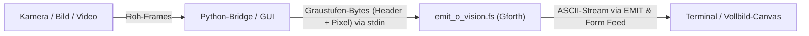

# EMIT-O-VISION

**EMIT-O-VISION** wandelt Live-Webcam-Feeds, Videos und hochauflösende Bilder in Echtzeit in dynamische ASCII-Grafik um. Die Bildverarbeitung und Zeichenausgabe per `EMIT` erfolgen dabei direkt in **Forth** (Gforth), während Python als Brücke zur Kamera- und Datei-Erfassung dient.

Das Projekt bietet sowohl eine grafische **Vollbild-Studio-App (PySide6)** als auch flexible **Kommandozeilen-Tools**.

---

## Funktionen

- **Echte Forth-Render-Engine ([`emit_o_vision.fs`](src/emit_o_vision/emit_o_vision.fs)):** Liest Graustufen-Bytes über eine Stream-Pipe ein, ordnet jedem Helligkeitswert ein Zeichen zu und rendert blitzschnell per `EMIT`.
- **EMIT-O-VISION Studio (GUI):**
  - Startet standardmäßig direkt im **Vollbildmodus**, umschaltbar in den **Fenstermodus** (per Button, `F11` oder `Esc`).
  - **Kopfleiste:** Kamera ein-/ausschalten, Bild- und Videodateien per Dateidialog oder **Drag & Drop** laden, Pause/Weiter, Geschwindigkeitsregler (Normal/Max), Schriftgröße anpassen (`A −` / `A +`) und Schnappschüsse direkt als `.txt`-Datei exportieren.
  - **Dynamische Auflösung:** Die Zeichenauflösung passt sich automatisch der Bildschirmgröße und Schriftgröße an.
- **Kommandozeilen-Pipeline ([`bridge.py`](src/emit_o_vision/bridge.py)):**
  - Live-Webcam im Terminal (`emit-o-vision-forth`).
  - Verarbeitung beliebiger Bild- und Videodateien (`--input`).
  - Export von ASCII-Frames in reine Textdateien (`--output datei.txt`).

---

## Architektur



### Datenformat (Stream-Protokoll)

Jeder Frame wird im Binärformat an Gforth übergeben:

| Abschnitt | Inhalt |
| --- | --- |
| Header (pro Frame, 4 Bytes) | Breite (`u16`) und Höhe (`u16`) als Little-Endian-Ganzzahlen |
| Pixel-Daten | `Breite × Höhe` Bytes (Grauwerte 0–255, zeilenweise) |

Am Ende jedes gerenderten Bildes gibt Forth ein `Form Feed`-Zeichen (`ASCII 12`) aus. Dadurch können sowohl die GUI als auch Dateiexporter einzelne Frames verlässlich voneinander trennen.

---

## Voraussetzungen

- **Python 3.14** oder neuer (laut `pyproject.toml` bzw. `.python-version`)
- **[uv](https://docs.astral.sh/uv/)** für Umgebung und Paketverwaltung
- **opencv-python** und **PySide6** (werden über `uv` automatisch installiert)
- **[Gforth](https://gforth.org/)**: Getestet mit Gforth 0.7.0 unter Windows (Standardpfad `C:\Program Files (x86)\gforth`). Wird automatisch im `PATH` und den Standardinstallationspfaden gefunden.

---

## Installation

```bash
git clone <REPOSITORY-URL>
cd EMIT-O-VISION
uv sync
```

---

## Verwendung

### 1. Grafische Benutzeroberfläche (Studio)

Startet die App direkt im Vollbild:

```bash
uv run emit-o-vision-studio
```

#### Tastenkürzel in der GUI

- `F11`: Vollbild / Fenstermodus umschalten
- `Esc`: Vollbild verlassen
- `Leertaste`: Wiedergabe pausieren / fortsetzen
- **Drag & Drop:** Beliebige Bilddatei (`.png`, `.jpg`, `.webp` etc.) oder Videodatei (`.mp4`, `.avi`, `.mkv` etc.) einfach ins Fenster ziehen.

---

### 2. Kommandozeile (Forth-Pipeline)

#### Live-Webcam im Terminal

```bash
uv run emit-o-vision-forth
```

#### Bild- oder Videodatei verarbeiten

```bash
# Bilddatei im Terminal als ASCII anzeigen
uv run emit-o-vision-forth --input mein_foto.jpg --width 120

# Videodatei im Terminal abspielen
uv run emit-o-vision-forth --input mein_video.mp4 --width 100
```

#### ASCII-Ausgabe in eine Textdatei exportieren

```bash
uv run emit-o-vision-forth --input mein_foto.png --width 140 --output ascii_art.txt
```

#### CLI-Optionen

| Option | Beschreibung | Standard |
| --- | --- | --- |
| `-i`, `--input` | Pfad zu einer Bild- oder Videodatei | Kamera |
| `-c`, `--camera` | Kamera-Index | `0` |
| `-w`, `--width` | Bildbreite in Zeichen | `100` |
| `--height` | Bildhöhe in Zeichen (optional) | Automatisch (Faktor 0.55) |
| `-o`, `--output` | Ziel-Textdatei (`.txt`) für ASCII-Export | Terminal |
| `--fps` | Bildrate manuell begrenzen | Quell-FPS |
| `--gforth` | Benutzerdefinierter Pfad zu `gforth.exe` | Automatisch |

---

### 3. Ursprünglicher Prototyp (rein Python, farbig)

```bash
uv run emit-o-vision
```

---

## Projektstruktur

```text
EMIT-O-VISION/
├── src/
│   └── emit_o_vision/
│       ├── __init__.py        # Paketdatei und Haupteinstiegspunkt
│       ├── gui.py             # PySide6 Vollbild-Studio-GUI
│       ├── bridge.py          # CLI-Runner für Kamera, Bild- und Videoverarbeitung
│       ├── sources.py         # Frame-Quellen (Webcam, Video, Bild, Drag & Drop)
│       ├── renderer.py        # Bidirektionale Prozess- und Streaming-Bridge zu Gforth
│       ├── emit_o_vision.fs   # Forth-Renderer: Graustufen-Bytes → ASCII per EMIT
│       └── webcam_ascii.py    # Ursprünglicher farbiger Python-Prototyp
├── docs/
│   └── ideas/
│       └── emit-o-vision-studio.md  # Konzeptionsdokument
├── .gitignore
├── .python-version            # Python-Version für uv
├── pyproject.toml             # Projekt-Metadaten, Abhängigkeiten und Startbefehle
├── uv.lock                    # Festgeschriebene Abhängigkeitsversionen
└── README.md                  # Dokumentation
```

---

## Helligkeitsskala anpassen

Die Helligkeitsstufen sind in [`emit_o_vision.fs`](src/emit_o_vision/emit_o_vision.fs) definiert:

```forth
\ Brightness ramp from dark to bright (first character is a space)
: charset ( -- c-addr u )  s"  .:-=+*#%@" ;

\ Maps a gray value 0..255 onto a character of the brightness ramp
: lum>char ( u8 -- char )  charset rot * 256 / + c@ ;
```

---

## Lizenz

Noch keine Lizenz festgelegt.
